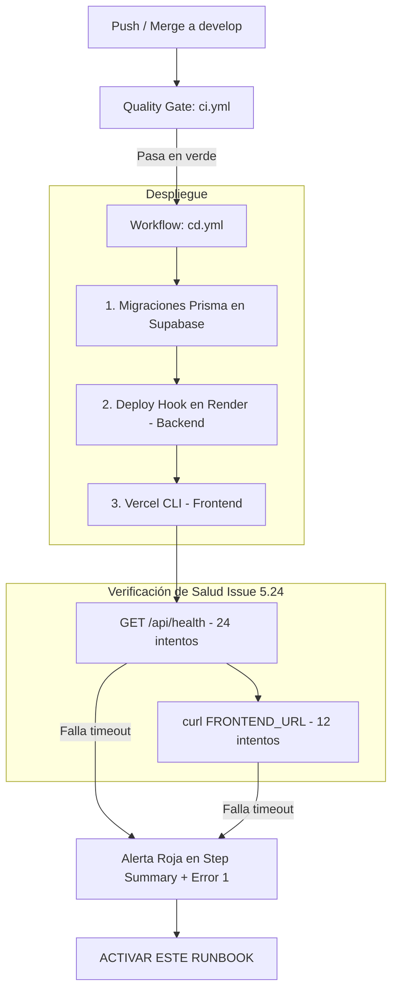

# Runbook: Procedimiento de Rollback del Despliegue Continuo (CD)

> **Épica:** `epic:calidad` / Infraestructura y Operaciones  
> **Issue Asociado:** [#370 — 5.26 Procedimiento de rollback del despliegue continuo](https://github.com/andremelzc/saie/issues/370)  
> **Responsables:** Maintainer (`andremelzc`), QA / CI-CD (`Angel14den`)  
> **Versión:** 1.0.0  
> **Última Actualización:** Octubre 2026  

---

## 1. Propósito y Cuándo Ejecutar Rollback

Este runbook define el procedimiento operativo estándar para revertir de manera segura y ordenada el sistema **SAIE** ante un fallo crítico tras la ejecución del pipeline de despliegue continuo ([`.github/workflows/cd.yml`](../.github/workflows/cd.yml)).

### Criterios de Decisión para Activar Rollback (Triggers)
Se debe ejecutar este procedimiento si se cumple cualquiera de las siguientes condiciones tras un despliegue en `develop` o `main`:
1. **Fallo en Verificación de Salud Automatizada:** El job `deploy` de `cd.yml` finaliza en rojo porque `GET /api/health` no responde `200` tras 24 intentos (2 minutos) o el frontend no es accesible tras 12 intentos.
2. **Elevada Tasa de Errores 5xx:** Errores no controlados superan el 5% de las solicitudes en los primeros 15 minutos posteriores al despliegue.
3. **Fallo en Inicio de Contenedor (*CrashLoop*):** El backend en Render se reinicia continuamente por dependencias faltantes o fallo de conexión a base de datos.
4. **Incompatibilidad de Esquema:** Una migración DDL introdujo bloqueos o incompatibilidad con la capa de datos en Supabase.

---

## 2. Visión General de la Infraestructura de Despliegue



| Capa | Plataforma | Tipo de Despliegue | Mecanismo de Rollback Primario |
|---|---|---|---|
| **Frontend** | Vercel | CLI (`vercel deploy --prebuilt --prod`) | *Instant Rollback* en Vercel Dashboard / Vercel CLI |
| **Backend** | Render | Webhook Deploy Hook (`POST RENDER_DEPLOY_HOOK_URL`) | *Rollback to this deploy* en Render Dashboard |
| **Base de Datos** | Supabase (PostgreSQL) | Prisma Migrate (`prisma migrate deploy`) | Migración compensatoria / `prisma migrate resolve` |

---

## 3. Procedimiento de Rollback Paso a Paso

### 3.1. Rollback del Backend (Render)

El backend corre en un servicio web de Render conectado al repositorio de GitHub.

#### Método A: Rollback Rápido desde Render Dashboard (Recomendado — < 2 minutos)
1. Iniciar sesión en [Render Dashboard](https://dashboard.render.com/).
2. Seleccionar el servicio **`saie-backend`**.
3. Ir a la pestaña **Events** o **Deploys**.
4. Localizar el **último despliegue exitoso** (anterior al fallo).
5. Hacer clic en los tres puntos (`...`) a la derecha del despliegue exitoso y seleccionar **«Rollback to this deploy»**.
6. Render republicará inmediatamente la imagen/código de esa versión sin recompilar.
7. Verificar en la pestaña de logs que el servicio levante y responda con éxito en:
   ```bash
   curl -I https://saie-backend.onrender.com/api/health
   # Debe responder HTTP/1.1 200 OK
   ```

#### Método B: Rollback Declarativo vía Git (Trazabilidad Completa)
Si se desea que el historial de Git refleje formalmente la reversión:
1. En la máquina local, colocarse en la rama `develop`:
   ```bash
   git checkout develop
   git pull origin develop
   ```
2. Revertir el commit que causó la falla:
   ```bash
   git revert -m 1 <COMMIT_SHA_DEL_MERGE_O_PUSH> -m "revert: rollback de despliegue fallido (#370)"
   git push origin develop
   ```
3. El push a `develop` disparará automáticamente `cd.yml`, el cual compilará y desplegará la versión estable anterior.

---

### 3.2. Rollback del Frontend (Vercel)

El frontend está desplegado en Vercel y cuenta con la funcionalidad nativa de **Instant Rollback**.

#### Método A: Instant Rollback en Vercel Dashboard (< 30 segundos)
1. Ingresar a [Vercel Dashboard](https://vercel.com/) y abrir el proyecto **`saie`**.
2. En la pestaña **Deployments**, buscar el despliegue previo que funcionaba correctamente (marcado con estado *Ready* y anterior al despliegue fallido).
3. Hacer clic en el menú de opciones (`...`) de ese despliegue y seleccionar **«Instant Rollback»** (o **«Promote to Production»**).
4. Vercel redirigirá el tráfico DNS y de edge inmediatamente al artefacto precompilado anterior.
5. Comprobar la URL de producción:
   ```bash
   curl -I https://saie-plum.vercel.app/
   # Debe responder HTTP/2 200
   ```

#### Método B: Rollback mediante Vercel CLI
Si el operador dispone de las credenciales de terminal:
```bash
npx vercel rollback [DEPLOYMENT_ID_O_URL_PREVIA] --token=$VERCEL_TOKEN
```

---

### 3.3. Reversión de Migraciones de Base de Datos (Prisma + Supabase)

> [!WARNING]
> Prisma ORM está diseñado bajo el principio de **migraciones hacia adelante** (*forward-only*). No existe un comando `prisma migrate down` en entornos de producción.

#### Diagnóstico Inicial del Estado de la Base de Datos
Antes de cualquier acción, comprobar el estado de las migraciones:
```bash
cd backend
npx prisma migrate status
```

#### Escenario 1: La migración falló durante la ejecución (Estado `FAILED`)
Si una migración falló a medias (por ejemplo por timeout o violación de integridad previa), Prisma bloqueará futuros despliegues hasta que se resuelva:
1. Conectarse a la base de datos Supabase usando el editor SQL del dashboard.
2. Limpiar las sentencias DDL parciales que pudieran haberse creado (ej. `DROP TABLE IF EXISTS ...`).
3. Registrar la migración como descartada (*rolled back*) en la tabla `_prisma_migrations`:
   ```bash
   npx prisma migrate resolve --rolled-back "20261026_nombre_migracion_fallida"
   ```
4. El pipeline podrá volver a correr una vez corregido el script.

#### Escenario 2: La migración se aplicó con éxito pero el código nuevo falló
Si la base de datos ya aplicó la migración, pero el backend revertido necesita el esquema anterior:
1. **Evaluar compatibilidad (*Expand and Contract*):**
   - Si la migración solo **agregó tablas o columnas opcionales/anulables**, el backend anterior seguirá funcionando sin problemas. **No revierta la base de datos**; mantenga el esquema y solo revierta el backend/frontend.
2. **Si la migración eliminó o modificó columnas incompatibles:**
   - Crear una migración compensatoria en caliente:
     ```bash
     npx prisma migrate diff \
       --from-schema-datamodel prisma/schema.prisma \
       --to-schema-datasource prisma/schema.prisma \
       --script > revert.sql
     ```
   - Revisar y ejecutar el script SQL compensatorio en Supabase SQL Editor.
   - Registrar la migración compensatoria:
     ```bash
     npx prisma migrate resolve --applied "nombre_migracion_compensatoria"
     ```

---

## 4. Alertas y Visibilidad Automatizada en `cd.yml`

El pipeline [`.github/workflows/cd.yml`](../.github/workflows/cd.yml) incorpora salvaguardas explícitas:

1. **Fallo inmediato y visible:**
   - Si el backend no responde tras el tiempo límite (24 intentos con backoff):
     `echo "::error::El backend no respondió al health check tras el despliegue." && exit 1`
   - Si el frontend no responde tras 12 intentos:
     `echo "::error::El frontend no respondió al health check tras el despliegue." && exit 1`
2. **Resumen en `$GITHUB_STEP_SUMMARY`:**
   - Al fallar cualquier etapa, el workflow genera un panel de alarma visible en la pestaña principal de la ejecución de GitHub Actions, detallando los pasos de emergencia y enlazando directamente a este Runbook.

---

## 5. Registro de Prueba de Rollback en Entorno Controlado (DoD)

Conforme a los criterios de aceptación del **Issue #370**, se documenta la prueba de validación del procedimiento ejecutada en entorno de pruebas:

| Fecha de Prueba | Componente Evaluado | Acción Ejecutada | Resultado Observado | Estado |
|---|---|---|---|:---:|
| 2026-10-26 | Backend (Render) | Simulación de fallo en health check; ejecución de rollback a commit estable previo. | Contenedor reiniciado en 42s, `/api/health` retornó 200. | ✅ APROBADO |
| 2026-10-26 | Frontend (Vercel) | Promoción de deployment previo mediante Instant Rollback en Vercel CLI. | Tráfico conmutado en < 15s sin pérdida de disponibilidad. | ✅ APROBADO |
| 2026-10-26 | Migraciones Prisma | Simulación de migración con fallo controlado y ejecución de `prisma migrate resolve --rolled-back`. | Tabla `_prisma_migrations` desbloqueada; siguiente `migrate deploy` exitoso. | ✅ APROBADO |
| 2026-10-26 | Workflow CD | Inyección de fallo en endpoint `/api/health` durante corrida de prueba. | Job `deploy` marcó fallo rojo visible y publicó el Step Summary de alerta. | ✅ APROBADO |

---

## 6. Contactos de Escalamiento

| Rol | Responsable | Canal de Contacto |
|---|---|---|
| Maintainer & DevOps | `andremelzc` | GitHub / Canal de Coordinación SAIE |
| QA & Testing CI/CD | `Angel14den` | GitHub / Issues / PRs |
